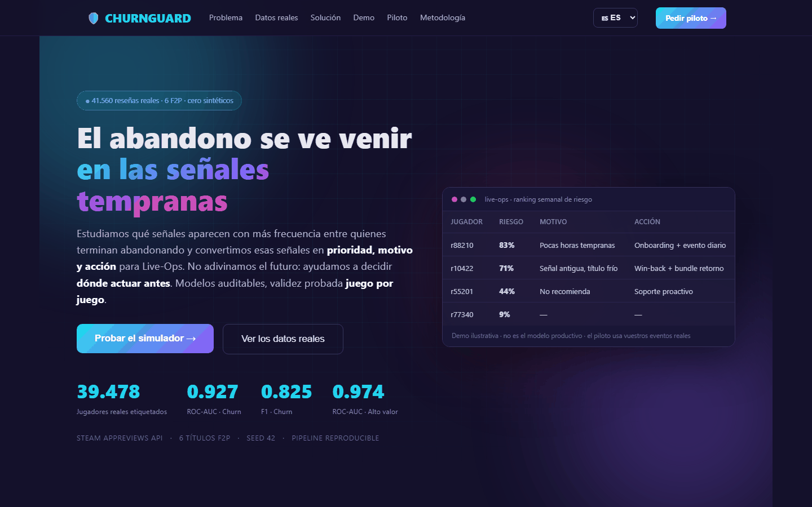
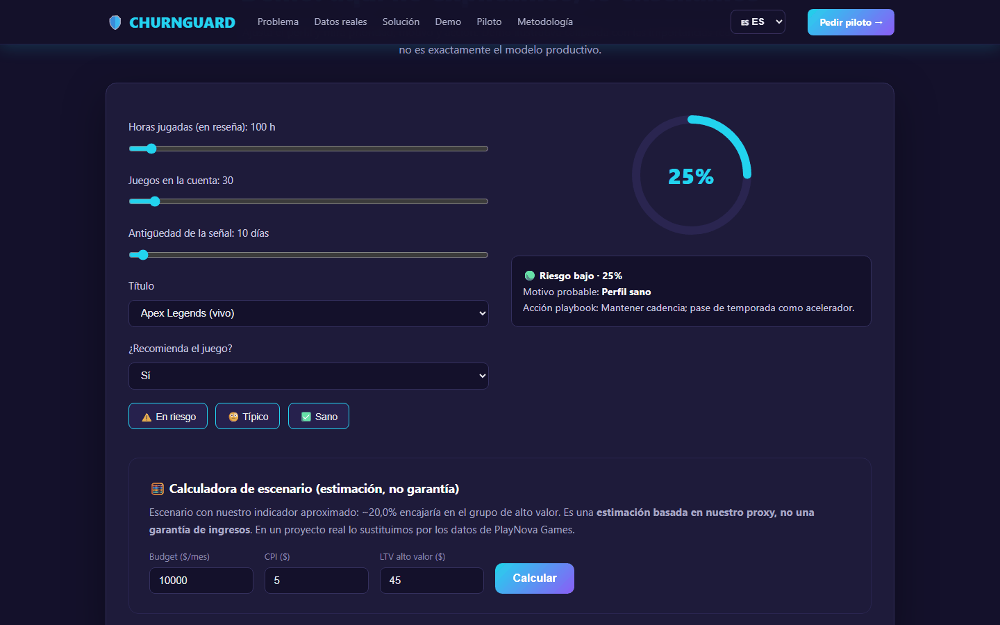

# ChurnGuard — retención de jugadores en juegos free-to-play

**Detecta qué jugadores de un juego gratuito de PC están en riesgo de abandonarlo, explica por qué y propone una acción.**

[](https://no-pain-no-game.vercel.app)    



## En resumen

- **Problema:** un juego free-to-play pierde jugadores sin saber quiénes ni por qué hasta que ya se han ido.
- **Datos:** 41.560 reseñas públicas de Steam de 6 juegos (Dota 2, Apex Legends, Fall Guys...), con horas jugadas y actividad reciente de cada autor.
- **Resultado:** modelo de churn con ROC-AUC de 0,93 (entre 0,85 y 0,92 dentro de cada juego) y una web que traduce la puntuación en motivo y acción.
- **Contexto:** planteado como la propuesta de una startup ficticia (*NO PAIN NO GAME*) a un cliente también ficticio (*PlayNova Games*). Los datos y los modelos son reales.

## Datos

- **Fuente:** API pública de reseñas de Steam (`appreviews`, sin key), descargada el 02/10/2026.
- **Juegos:** Dota 2, Team Fortress 2, Warframe, Path of Exile, Apex Legends y Fall Guys (unas 7.000 reseñas por juego).
- **Variables:** de cada autor, horas jugadas totales, en el momento de la reseña y en las últimas dos semanas, fecha de última partida, juegos en la cuenta y número de reseñas; de cada reseña, el voto, la longitud del texto, el idioma y si el juego fue gratis o reembolsado.
- **Etiqueta de churn:** al menos 2 h jugadas, 0 minutos en las últimas dos semanas y más de 30 días sin jugar. Activo: ha jugado en las últimas dos semanas. Los casos ambiguos (2.082) se descartan, y quedan **39.478 jugadores etiquetados, con un 34,5 % de churn**.

Procedencia completa en [docs/08_datos_reales.md](docs/08_datos_reales.md).

## Hallazgos

Detalle y gráficos en [docs/04_analisis.md](docs/04_analisis.md) y [notebooks/EDA.ipynb](notebooks/EDA.ipynb).

- **El enganche temprano protege:** el churn baja del 44,1 % entre quienes llevaban ≤19 h al reseñar al 22,1 % entre quienes llevaban más de 498 h.
- **Gustar no retiene:** el churn es casi igual entre quienes recomiendan el juego (34,3 %) y quienes no (35,2 %).
- **Cada juego está en una fase distinta:** en la muestra, el churn va del 6,4 % de Dota 2 al 93,7 % de Fall Guys. Son tasas entre reseñistas, no la retención real de cada juego, pero ordenan bien su momento de vida.

## Modelos



Dos Random Forest (scikit-learn) entrenados en `src/train_real.py`. Las variables que definen las etiquetas (horas totales, últimas dos semanas, última partida) no entran en el modelo.

| Modelo | Qué predice | ROC-AUC | PR-AUC (base) | F1 |
|---|---|---|---|---|
| Churn | Jugador inactivo | 0,927 | 0,892 (0,345) | 0,825 |
| Valor | Top 25 % de horas y recomienda el juego | 0,974 | 0,877 (0,200) | 0,841 |

Evaluación en un test de 7.896 jugadores; por juego, el ROC-AUC del modelo de churn va de 0,852 a 0,917 (`src/eval_per_title.py`). Las métricas se reproducen ejecutando `python src/train_real.py`.

## Limitaciones

- **Muestra de reseñistas:** quien escribe una reseña no representa a todos los jugadores.
- **Antigüedad de la reseña:** es la variable con más peso del modelo de churn (0,55). Es una señal legítima, pero las ventanas de reseñas son muy distintas entre juegos (21 días en Dota 2 frente a más de 800 en Fall Guys), así que parte de lo que aprende el modelo es el momento de cada juego.
- **Modelo de valor:** no hay datos de gasto. "Valor" es un indicador aproximado (horas + recomendación), y como las horas en la reseña están muy relacionadas con las horas totales, su ROC-AUC alto debe leerse con cautela.
- **Umbral único:** con prevalencias del 6 % al 94 %, un umbral global de 0,5 da F1 muy distintos por juego; habría que calibrarlo por título.
- **Demo web:** el simulador de la web es una versión ilustrativa calibrada a partir de los resultados, no ejecuta el `.pkl` entrenado.

## Ejecutarlo

La web es estática (`web/`):

```bash
cd web
python -m http.server 8321   # http://localhost:8321
```

Pipeline de datos y modelos:

```bash
pip install -r requirements.txt
python src/fetch_steam_reviews.py    # descarga las reseñas (~15 min)
python src/build_real_dataset.py     # crea data/playnova_real.db
python src/train_real.py             # entrena los modelos en models/
python src/eval_per_title.py         # métricas por juego
```

La base (`data/playnova_real.db`) y los modelos ya están en el repo, así que el notebook y el entrenamiento funcionan sin volver a descargar nada.

## Estructura

```text
├── web/          # Página con el problema, los datos, la solución y el simulador (ES/EN/FR/DE)
├── src/          # Descarga, construcción del dataset, entrenamiento y evaluación
├── data/         # Base SQLite y resumen
├── models/       # Modelos entrenados y métricas
├── notebooks/    # EDA
└── docs/         # Cliente y modelo de datos, análisis, solución y fuentes
```

El despliegue en Vercel sirve la carpeta `web/` (ver `vercel.json`).

## Tecnologías

Python, Pandas, scikit-learn, SQLite, Jupyter, Matplotlib y HTML/CSS/JavaScript.

## Autor

Álvaro Domingo Cordón · [LinkedIn](https://www.linkedin.com/in/alvaro-domingo/) · [GitHub](https://github.com/alvarodc093-pixel)
